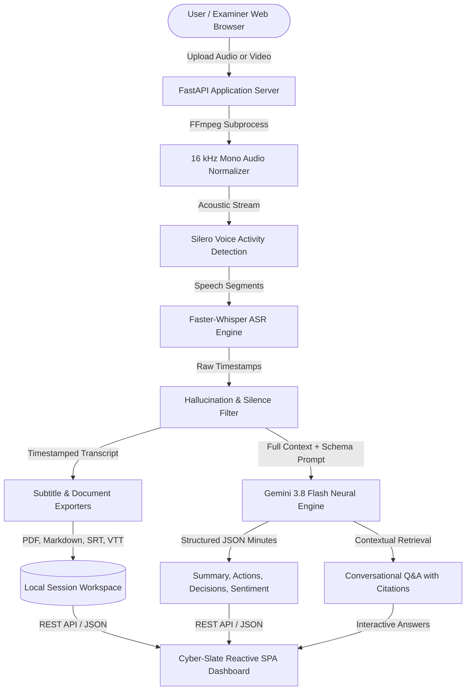

# AI-Powered Meeting & Conversation Intelligence System

An end-to-end, full-stack artificial intelligence platform for automated multimedia transcription, synchronized subtitle playback, and generative conversation intelligence (executive minutes of meeting, structured action items, consensus tracking, and grounded conversational Q&A).

Designed and engineered as an advanced academic capstone project and enterprise-grade productivity solution.

---

## 📌 Abstract & Research Motivation

In modern academic and organizational environments, vast amounts of critical knowledge exchanged during lectures, seminars, and stakeholder meetings remain trapped in unstructured audio and video recordings. Manual transcription and documentation are labor-intensive, error-prone, and lack interactivity.

This project introduces a **full-stack, modular AI pipeline** that addresses this challenge:
1. **Acoustic Preprocessing**: Normalizes incoming multimedia streams via FFmpeg to a 16 kHz mono acoustic baseline.
2. **Accelerated ASR**: Performs robust Speech-to-Text using **Faster-Whisper** with Silero Voice Activity Detection (VAD) to yield precise word- and segment-level timestamps while eliminating silence hallucinations.
3. **Synchronized Playback**: Bridges the gap between text and media with an interactive HTML5 player featuring bidirectional click-to-seek and dynamic subtitle karaoke tracking.
4. **Generative Intelligence**: Leverages **Google Gemini 3.8 Flash** via a decoupled Abstract Base Class architecture to synthesize structured Minutes of Meeting (MoM), categorized topics, priority action items, consensus decisions, and overall meeting tone.
5. **Grounded Conversational Q&A**: Employs in-context retrieval to allow users to query the meeting transcript, returning verified answers with clickable timestamp citations.
6. **Publication & Archival**: Produces formal academic/corporate PDF reports (compiled with ReportLab), GitHub-flavored Markdown, and standardized subtitle files (`.srt`, `.vtt`).

---

## 🌟 Key Functional Pillars

### 1. Multimedia Ingestion & Acoustic Normalization
- Universal container support: `.mp4`, `.mkv`, `.mov`, `.webm`, `.avi`, `.mp3`, `.wav`, `.m4a`.
- Automated audio extraction, dynamic range normalization, and 16 kHz mono conversion via FFmpeg.
- Client-side and server-side file validation with disk usage diagnostics.

### 2. High-Precision ASR & Hallucination Suppression
- Utilizes **Faster-Whisper** (CTranslate2 inference engine) with 8-bit quantization for high-throughput speech recognition on commodity CPUs and GPUs.
- **Two-Tier Silence Suppression**: Integrated Silero VAD prevents processing non-speech audio, while a regex/heuristic cleaner strips repetitive punctuation loops and typical hallucination artifacts.
- Dual-granularity output: Segment boundaries and individual word-level floating-point timestamps.

### 3. Interactive Word-Synchronized Dashboard
- **Bidirectional Media Synchronization**: The transcript dynamically highlights and auto-scrolls to the active segment matching the media playback head.
- **Click-to-Seek**: Clicking any sentence immediately seeks the audio/video player to the exact millisecond.
- **Real-Time Transcript Filtering**: Instant client-side search with match counters and keyword highlighting.

### 4. Generative Conversation Intelligence
- Powered by the modern Google GenAI SDK with **Gemini 3.8 Flash** as the default high-speed neural engine, backed by an automated model fallback chain (`gemini-2.5-flash`, `gemini-flash-latest`).
- **Executive Summary (TL;DR)**: Concise multi-paragraph synthesis of the overarching discourse.
- **Structured Discussion Topics**: Thematic groupings accompanied by key points and supporting arguments.
- **Interactive Action Items Tracker**: Tabular task extraction including assignee, priority classification (High, Medium, Low), deadline detection, and interactive completion status toggles.
- **Consensus & Decision Log**: Formal record of conclusions and agreements reached by participants.
- **Meeting Sentiment Analysis**: Algorithmic classification of conversation tone (Constructive, Positive, Neutral, Critical).

### 5. Conversational "Ask the Meeting" (Q&A Engine)
- Natural language chat interface grounded strictly in the full timestamped transcript context.
- Returns factual, context-aware responses with **clickable timestamp citations** (e.g., `[04:12]`) that jump playback directly to the cited proof point in the media.
- Built-in network retry mechanisms with exponential backoff and interactive retry recovery for transient connectivity drops.

### 6. Document Generation & Privacy Governance
- One-click compilation of formal **Minutes of Meeting (MoM) in PDF format** with structured typography and header styling using ReportLab.
- Clean GitHub-Flavored Markdown (`.md`), SubRip (`.srt`), and WebVTT (`.vtt`) subtitle exports.
- **Complete Local Governance**: Meeting metadata, audio tracks, and transcripts are stored strictly locally with one-click permanent data deletion capabilities.

---

## 🏗️ System Architecture & Data Flow



---

## 💻 Technology Stack & Specifications

| Layer | Technology | Purpose |
| :--- | :--- | :--- |
| **Backend Framework** | FastAPI (Python 3.10+) | High-performance asynchronous REST API, OpenAPI/Swagger docs |
| **Speech-to-Text (ASR)** | Faster-Whisper (CTranslate2) | 8-bit quantized transformer inference for rapid STT |
| **Acoustic Preprocessing** | FFmpeg & `ffmpeg-python` | Stream extraction, channel downmixing, dynamic normalization |
| **Voice Activity Detection** | Silero VAD | Non-speech boundary segmentation |
| **Generative AI Engine** | Google Gemini 3.8 Flash | Executive summary synthesis, MoM generation, grounded Q&A |
| **Document Compilation** | ReportLab | Publication-quality PDF generation with tabular layouts |
| **Frontend Architecture** | Modern Vanilla HTML5, CSS3, JS | Responsive SPA with glassmorphism, zero heavy framework dependencies |
| **Data Serialization** | Pydantic v2 | Strict schema validation and data integrity |

---

## 📁 Repository Structure

```
AI powered meeting and conversation intelligence system/
├── config.py                      # Central configuration (paths, model defaults, API keys)
├── requirements.txt               # Production Python dependencies
├── main.py                        # FastAPI application entrypoint & REST endpoints
├── README.md                      # Comprehensive project documentation
├── .env.example                   # Environment configuration template
├── .gitignore                     # Git ignore rules
│
├── core/                          # Modular core business logic (UI-independent)
│   ├── __init__.py
│   ├── models.py                  # Pydantic schemas (Transcript, ActionItems, Analysis)
│   ├── extractor.py               # FFmpeg audio extraction & acoustic normalization
│   ├── transcriber.py             # Faster-Whisper ASR pipeline & timestamp generation
│   ├── cleaner.py                 # Silence & subtitle hallucination filtering algorithms
│   ├── exporter.py                # MoM PDF, Markdown, SRT, and VTT generators
│   └── intelligence/              # Generative AI sub-package
│       ├── __init__.py
│       ├── base.py                # Abstract Base Class (LLMProvider) for extensibility
│       ├── prompts.py             # System prompts with JSON schema constraints
│       ├── gemini_provider.py     # Gemini 3.8 Flash provider with automatic retry backoff
│       └── analyzer.py            # Orchestrator for meeting analysis & Q&A
│
├── static/                        # Frontend client assets
│   ├── index.html                 # Cyber-Slate single-page interface
│   ├── favicon.svg                # Application vector favicon
│   ├── favicon.ico                # Root browser favicon
│   ├── img/
│   │   └── logo.svg               # Transparent brand logo with neural synapse & soundwave
│   ├── css/
│   │   └── style.css              # Design system, micro progress bars, modal layouts
│   └── js/
│       └── app.js                 # Media sync, transcript search, chat & session manager
│
├── temp/                          # Temporary scratch audio and video segments
├── output/                        # Persisted transcripts, exported reports, and MoMs
└── models/                        # Cached Faster-Whisper neural model weights
```

---

## 🚀 Installation & Execution Guide

### 1. Prerequisites
- **Python**: Version 3.10 to 3.13.
- **FFmpeg**: Installed and accessible via the system PATH (`ffmpeg -version`).

### 2. Virtual Environment Setup
```bash
# Clone the repository
git clone https://github.com/tankkulwant/AI-Meeting-and-Conversation-Intelligence-System.git
cd "AI powered meeting and conversation intelligence system"

# Create virtual environment
python -m venv .venv

# Activate virtual environment
# Windows PowerShell:
.\.venv\Scripts\Activate.ps1
# Linux / macOS:
source .venv/bin/activate

# Install required dependencies
pip install -r requirements.txt
```

### 3. Environment Configuration
Copy `.env.example` to `.env` or configure parameters directly:
```ini
# Google Gemini API Key (Obtain a free key at: https://aistudio.google.com/)
GEMINI_API_KEY=your_gemini_api_key_here
GEMINI_MODEL=gemini-3.8-flash

# Whisper Configuration
WHISPER_MODEL=base
WHISPER_DEVICE=cpu
WHISPER_COMPUTE_TYPE=int8

# Server settings
SERVER_HOST=127.0.0.1
SERVER_PORT=8000
```
> *Note: The Gemini API Key can also be entered or tested dynamically within the web dashboard's **System Settings** modal without restarting the server.*

### 4. Running the Server
```bash
python main.py
```
Access the application:
- **Web Dashboard**: [http://127.0.0.1:8000](http://127.0.0.1:8000)
- **Interactive OpenAPI Documentation (Swagger UI)**: [http://127.0.0.1:8000/docs](http://127.0.0.1:8000/docs)

---

## 🏛️ Technical Defense & System Architecture FAQ

### Q1: Why adopt Faster-Whisper over standard PyTorch OpenAI Whisper?
> **Answer**: Standard Whisper runs unquantized transformer weights on PyTorch, which requires significant VRAM and experiences high computational overhead. Faster-Whisper is built on **CTranslate2**, a custom C++ inference library optimized for transformer execution. It utilizes **8-bit integer quantization (INT8)** and batching optimizations that yield up to **4x faster execution** and reduce memory footprint by ~70%, making word-level speech recognition feasible on consumer-grade CPUs without dedicated high-end GPUs.

### Q2: How does the system mitigate Whisper hallucinations during long silent pauses?
> **Answer**: The system applies a two-tier defense strategy:
> 1. **Acoustic Pre-filtering via Silero VAD**: Non-speech segments and background noise intervals are detected and clipped prior to reaching the ASR acoustic model.
> 2. **Post-processing Heuristic Filter (`cleaner.py`)**: A rule-based parser inspects transcription segments for repetitive token loops, punctuation spam (e.g., `... ... ...`), and known subtitle hallucinations (e.g., `"Thank you for watching"`, `"Subtitles by..."`), discarding them before context injection into the LLM.

### Q3: How is video-to-transcript synchronization achieved without external timecode sync devices?
> **Answer**: Faster-Whisper calculates floating-point start and end timestamps for every utterance. In the client application ([`app.js`](file:///c:/Users/tankk/VS%20CODE%20PROJECTS/youtube-tools/AI%20powered%20meeting%20and%20conversation%20intelligence%20system/static/js/app.js)), an event listener attached to the HTML5 media element listens for `timeupdate` signals. By cross-referencing `currentTime` with segment interval boundaries using binary search indexing, the active subtitle row is styled with glowing CSS highlights and smoothly brought into view using `scrollIntoView({ behavior: 'smooth', block: 'center' })`.

### Q4: Why is the LLM architecture decoupled using an Abstract Base Class (`LLMProvider`)?
> **Answer**: Software engineering principles of loose coupling and interface segregation dictate that high-level intelligence orchestration ([`analyzer.py`](file:///c:/Users/tankk/VS%20CODE%20PROJECTS/youtube-tools/AI powered meeting and conversation intelligence system/core/intelligence/analyzer.py)) must not depend directly on concrete cloud SDKs. By defining an abstract interface ([`base.py`](file:///c:/Users/tankk/VS%20CODE%20PROJECTS/youtube-tools/AI powered meeting and conversation intelligence system/core/intelligence/base.py)), the system can alternate between cloud providers (Google Gemini) and air-gapped, on-premise local models (such as Ollama/Llama 3 or Mistral) without modifying core endpoints or user-facing presentation layers.

### Q5: Why is Google Gemini 3.8 Flash selected as the primary neural engine?
> **Answer**: Gemini 3.8 Flash provides sub-second time-to-first-token (TTFT) latency, cost-effective API rates, and a massive native context window (>1M tokens). This allows whole meeting transcripts spanning multiple hours to be ingested in a single context window without lossy chunking, preserving holistic discourse context for cross-segment reasoning and action item attribution.

### Q6: How does the conversational Q&A system prevent factual hallucinations?
> **Answer**: The Q&A subsystem enforces grounded in-context prompting. The prompt explicitly instructs the LLM that it is an objective meeting auditor and mandates that answers must cite verbatim meeting evidence alongside bracketed time intervals (e.g., `[14:22 - 14:45]`). The frontend parses these citation brackets and renders them into interactive, clickable jump pills that allow examiners and users to immediately verify assertions against the source audio/video.

### Q7: How does the application handle data privacy and disk management?
> **Answer**: All media processing occurs on the local machine. Uploaded files, normalized audio WAVs, generated transcripts, and PDF reports reside strictly in designated local directories (`temp/` and `output/`). The UI includes an explicit **"Delete Data"** action that triggers atomic disk cleanup of all media, audio, and metadata artifacts, ensuring zero lingering footprint.

---

## 🔬 Academic Citations & References

1. **Whisper ASR**: Radford, A., Kim, J. W., Xu, T., Brockman, G., McLeavey, C., & Sutskever, I. (2022). *Robust Speech Recognition via Large-Scale Weak Supervision*. arXiv:2212.04356.
2. **CTranslate2 Engine**: Klein, G., Hernandez, D., Nguyen, V., & Senellart, J. (2020). *OpenNMT: Neural Machine Translation Toolkit*.
3. **Voice Activity Detection**: Silero Team. (2021). *Silero VAD: Pre-trained Enterprise-Grade Voice Activity Detector*. GitHub repository.
4. **Gemini Models**: Google DeepMind. (2024). *Gemini: A Family of Highly Capable Multimodal Models*. Technical Report.

---

## 📄 License

This project is developed and distributed under the **MIT License**. Suitable for academic evaluation, research, and non-commercial educational deployment.
