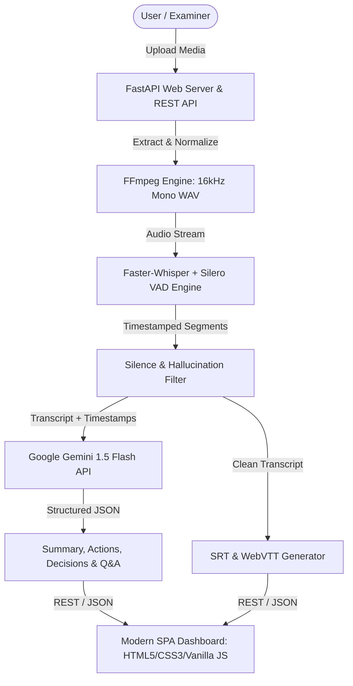

# AI-Powered Meeting & Conversation Intelligence System

An end-to-end, full-stack AI system for automated meeting transcription, synchronized subtitle playback, and generative meeting intelligence (executive summaries, key decisions, action items, and conversational Q&A).

Developed for academic submission and real-world meeting productivity.

---

## 🌟 Key Features

1. **Universal Audio/Video Ingestion**:
   - Supports `.mp4`, `.mkv`, `.mov`, `.webm`, `.avi`, `.mp3`, `.wav`, `.m4a`.
   - Uses FFmpeg to extract, re-sample to 16 kHz mono, and dynamically normalize audio streams.

2. **Accurate Speech-to-Text & Subtitles**:
   - Powered by **Faster-Whisper** with Silero VAD (Voice Activity Detection) to eliminate silence hallucinations.
   - Generates both segment-level and word-level timestamps.
   - Automatically exports `.srt` (SubRip) and `.vtt` (WebVTT) subtitle tracks.

3. **Interactive Synced Media Player**:
   - Split-screen dashboard: video/audio player on the left, interactive transcript on the right.
   - **Real-Time Synchronized Highlighting**: The transcript automatically highlights the active line as the video plays and auto-scrolls.
   - **Click-to-Seek**: Click any sentence in the transcript to instantly jump playback to that second.
   - **Real-Time Keyword Search**: Instant transcript filtering with term highlighting.

4. **Generative AI Intelligence Engine (Google Gemini API)**:
   - **Executive Summary (TL;DR)**: Structured 2-4 paragraph overview of the conversation.
   - **Key Discussion Topics**: Categorized themes with bullet points of arguments and metrics.
   - **Action Items Table**: Formatted table with Task Description, Assignee, Deadline, and Priority.
   - **Decisions & Agreement Log**: Log of consensus reached by participants.
   - **Conversation Tone / Sentiment**: Classification of discussion tone (Positive, Constructive, Neutral, Critical).

5. **"Ask the Meeting" (Interactive Conversational Q&A)**:
   - Chat interface to ask questions about the meeting (e.g. *"What did John say about the Q3 budget?"*).
   - Responses include **clickable timestamp citations** (e.g. `[01:23]`) that jump the player directly to the proof in the video.

6. **Export Center (Minutes of Meeting - MoM)**:
   - One-click export to **Formal PDF Report** (formatted with ReportLab).
   - **GitHub-Flavored Markdown (`.md`)**.
   - Subtitle tracks (`.srt` and `.vtt`).

---

## 🏗️ Architecture & Technology Stack



* **Backend Framework**: FastAPI (Python 3.10+)
* **Speech-to-Text (ASR)**: Faster-Whisper (CTranslate2)
* **Audio Processing**: FFmpeg & `ffmpeg-python`
* **Generative AI / LLM**: Google Gemini 1.5 Flash via `google-generativeai` / `google-genai`
* **Document Generation**: ReportLab (PDF)
* **Frontend**: Responsive Single-Page Application (HTML5, Vanilla CSS, Vanilla JavaScript, FontAwesome, Google Fonts)
* **API Documentation**: Interactive Swagger UI at `/docs`

---

## 📁 Directory Structure

```
AI powered meeting and conversation intelligence system/
├── config.py                      # Central configuration (paths, model defaults, API keys)
├── requirements.txt               # Dependencies
├── main.py                        # FastAPI application & REST endpoints
├── README.md                      # Complete project documentation
├── .env.example                   # Environment variable template
├── .gitignore                     # Git ignore rules
│
├── core/                          # Decoupled business logic
│   ├── __init__.py
│   ├── models.py                  # Pydantic data schemas
│   ├── extractor.py               # FFmpeg audio extraction & normalization
│   ├── transcriber.py             # Faster-Whisper transcription & timestamps
│   ├── cleaner.py                 # Whisper hallucination & silence filter
│   ├── exporter.py                # MoM PDF, Markdown, SRT, and VTT generators
│   └── intelligence/              # Pluggable AI engine
│       ├── __init__.py
│       ├── base.py                # Abstract Base Class for LLM providers
│       ├── prompts.py             # Engineered system prompts
│       ├── gemini_provider.py     # Google Gemini API implementation
│       └── analyzer.py            # Analysis & Q&A orchestrator
│
├── static/                        # Frontend dashboard
│   ├── index.html                 # Single-page interface
│   ├── css/
│   │   └── style.css              # Dark mode styling & animations
│   └── js/
│       └── app.js                 # Media sync, transcript search, chat & exports
│
├── temp/                          # Scratch media & audio files
├── output/                        # Saved transcripts, summaries, and PDF MoMs
└── models/                        # Local Whisper model weights cache
```

---

## 🚀 How to Run the Project

### 1. Prerequisites
- Python 3.10 - 3.13 installed
- FFmpeg installed system-wide (`ffmpeg -version` in terminal)

### 2. Environment Setup
```bash
# Activate virtual environment
.\.venv\Scripts\Activate.ps1   # Windows PowerShell
# or: source .venv/bin/activate  # macOS / Linux
```

### 3. Configure Gemini API Key
Create a `.env` file in the root directory (or click **Settings** inside the web dashboard):
```ini
GEMINI_API_KEY=your_gemini_api_key_here
GEMINI_MODEL=gemini-1.5-flash
WHISPER_MODEL=base
```
*(Get a free API key at [Google AI Studio](https://aistudio.google.com/app/apikey))*

### 4. Start the Application
```bash
python main.py
```
Open your browser and navigate to:
- **Interactive Dashboard**: [http://127.0.0.1:8000](http://127.0.0.1:8000)
- **Interactive REST API Docs (Swagger UI)**: [http://127.0.0.1:8000/docs](http://127.0.0.1:8000/docs)

---

## 🎓 College Viva & Evaluation Cheat Sheet

**Q: Why use Faster-Whisper instead of original OpenAI Whisper?**
> *Answer:* Faster-Whisper uses CTranslate2 (a custom C++ inference engine with 8-bit quantization). It runs up to 4x faster with significantly lower memory footprint, allowing word-level transcription to run efficiently even on standard consumer CPUs without requiring a dedicated high-end GPU.

**Q: How does the system prevent Whisper hallucinations during silence?**
> *Answer:* Two-tier defense: (1) Silero VAD (Voice Activity Detection) filters out non-speech audio chunks before Whisper processes them. (2) The `cleaner.py` module applies regex and heuristic filtering to detect repetitive punctuation loops, single-character spam, and common subtitle hallucinations.

**Q: How does video-transcript synchronization work?**
> *Answer:* Faster-Whisper extracts start and end floating-point timestamps for every segment. In the web UI, the HTML5 video/audio player's `timeupdate` event listener continuously checks the current playback head against these boundaries, dynamically applying CSS highlights and auto-scrolling into view.

**Q: Why a pluggable LLM interface?**
> *Answer:* The `LLMProvider` abstract base class isolates the Generative AI logic. If an organization requires local/offline privacy, we can plug in an Ollama provider without changing a single endpoint or UI component.
